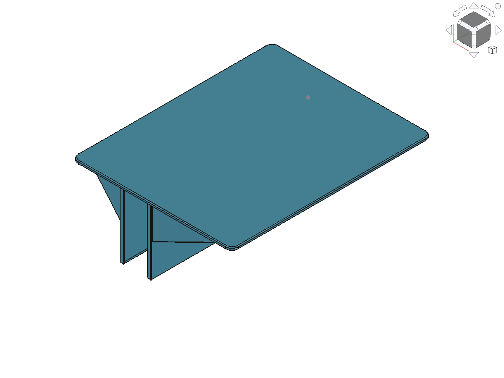

# 一體式床邊架 v3

- 250 mm 沿床板，200 mm 為跨床板方向的平臺總深度。
- 平臺厚 4 mm、夾壁厚 5 mm、夾深 90 mm；總尺寸 200 × 250 × 94 mm。
- 夾槽 28.9 mm，適配名義厚度 28.7 mm 木板，總裝配間隙 0.2 mm。
- 四片一體三角支撐：內外夾壁各兩片，沿床方向左右端各一片；厚 4 mm，從平臺底向下最多 50 mm。
- 平臺四角 R8、上下周緣 R1；夾片及三角支撐外緣 R0.6。保留夾口末端導入斜角。
- 無螺絲、彈片或組裝配件。無主動鎖緊與防拔功能。

## 最新檔案

- `models/BedsideShelf.FCStd`：FreeCAD 工作檔；Shelf 是本體，隱藏的 BoardReference 不列印。
- `exports/current/`：最新版 STL、STEP。
- `manufacturing/current/`：A1 專用 3MF，可在 Bambu Studio 開啟。
- `source/`：FreeCAD 重建與切片腳本。
- `previews/current/`：目前模型預覽圖。
- `reports/current/`：幾何檢查紀錄。

[STL](exports/current/bedside_shelf_v3.stl) · [STEP](exports/current/bedside_shelf_v3.step) · [Bambu Studio 3MF](manufacturing/current/bedside_shelf_v3_A1_PETG.3mf)

從根目錄切片請執行 `python -B source/slice_check.py`；在 FreeCAD 執行 `source/build_shelf.py` 重建模型。
FreeCAD 重建腳本會更新 `models/BedsideShelf.FCStd`，並產生 STL、STEP 與驗證紀錄。要建立新版時，先在腳本內調高 `VERSION`。

## 2026-09-27 驗證紀錄

- FreeCAD check_geometry：1 個有效封閉實體，200 × 250 × 94 mm、104 個面、體積 433,867.573 mm³。
- 四片三角支撐與本體融合，位置在夾槽外；與木板的交集為 0。
- STL 重新讀取：封閉，尺寸符合；已檢視等角、正面、頂面、底面。
- `0.20 mm Standard`、0.4 mm 噴嘴、PETG；切片腳本只設 4 圈牆與關閉支撐，其餘沿用預設。
- 從根目錄執行 `python -B source/slice_check.py` 可重新切片。

- 4 圈牆、預設 15% gyroid，支撐關閉；預估 341.6 g、11 小時 18 分。
- 尚未實印；裝配公差、1.5 kg 承重及長期蠕變均未驗證，不能視為已認證承重。

## 授權

目前未指定開源授權。
